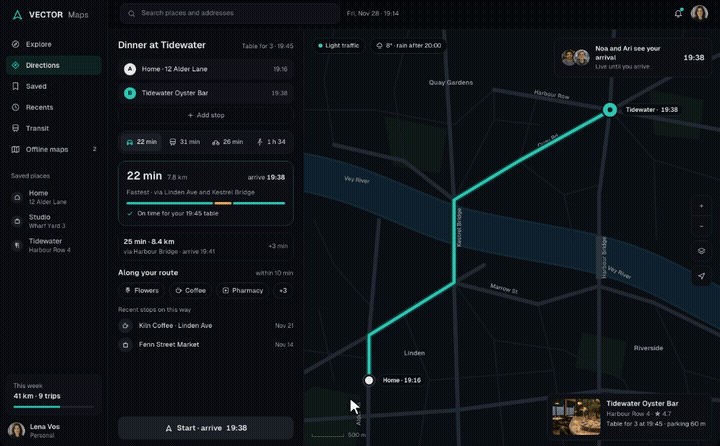

# Add a Stop

**Flowers on the way to dinner, and still on time for the table.**



**Live demo:** [veraetogrex-portfolio.github.io/add-stop](https://veraetogrex-portfolio.github.io/add-stop/) · **Mockup:** [full-screen version](https://veraetogrex-portfolio.github.io/add-stop/mockup/add-stop.html)

A maps directions screen: Flowers shows florists along the route with the detour, Add stop grows the route through the shop as stop 1 and recounts the arrival for you and your friends. Vanilla HTML/CSS/JS, zero dependencies.

## Try it

- Press Flowers under "Along your route". Three florists appear in the list and on the map, and the detour to Petal & Twine draws itself as a dashed line with "+6 min". Press Flowers again to go back to the route.
- Press Add stop on Petal & Twine. The route grows along the dashed detour in 0.8 s, the pin turns into stop 1 and a "Petal & Twine · 19:27 · 5 min" row slides in between A and B.
- Watch the numbers while the line grows: 22 → 28 min, arrival 19:38 → 19:44 in the route card, on the Start button, on the map and in Noa and Ari's card. The old way over Kestrel Bridge fades to a grey dashed line.
- Press Add stop or Flowers again mid-animation — you still end up with one stop and 19:44.
- Click a travel mode tab (car, transit, bike, walk) to select it.
- Keyboard: Tab to Flowers or Add stop and press Enter or Space; in the travel modes, arrow keys move the selection.

## Use it

Three files and the photos, no build step, no dependencies:

```
index.html   markup
style.css    styles
script.js    logic
assets/      the photos (generated, free to reuse with the code)
```

Download the repo and open `index.html`, or copy the files into your project. Set `data-assets` on `<section class="vm">` to the folder with your photos.

## License

MIT
